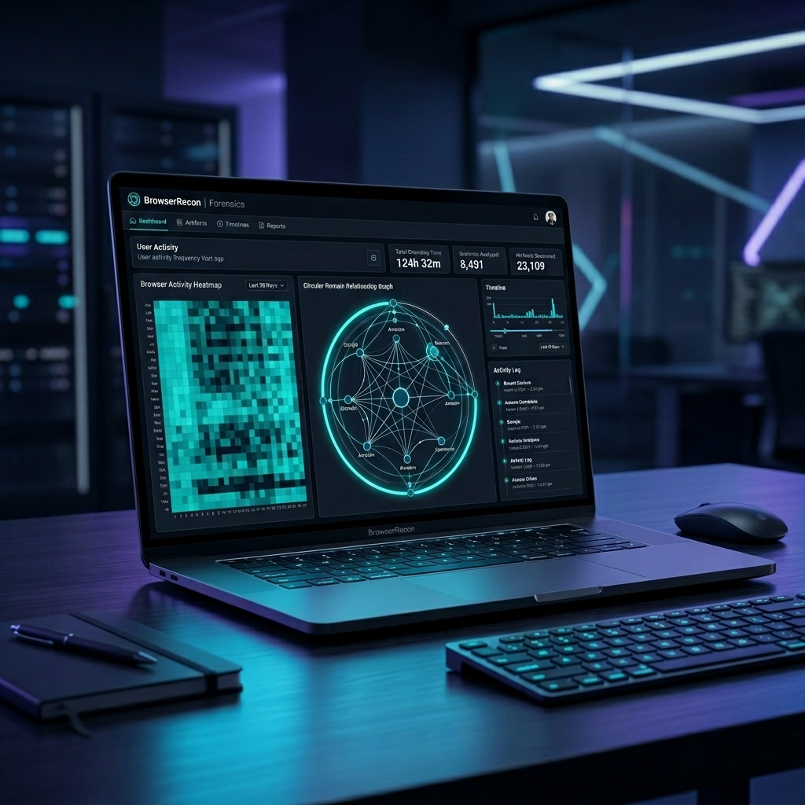
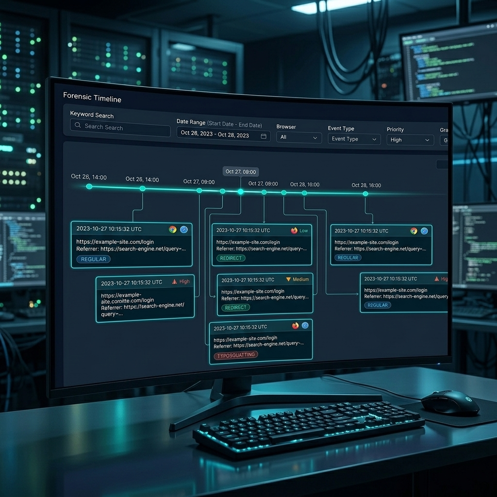
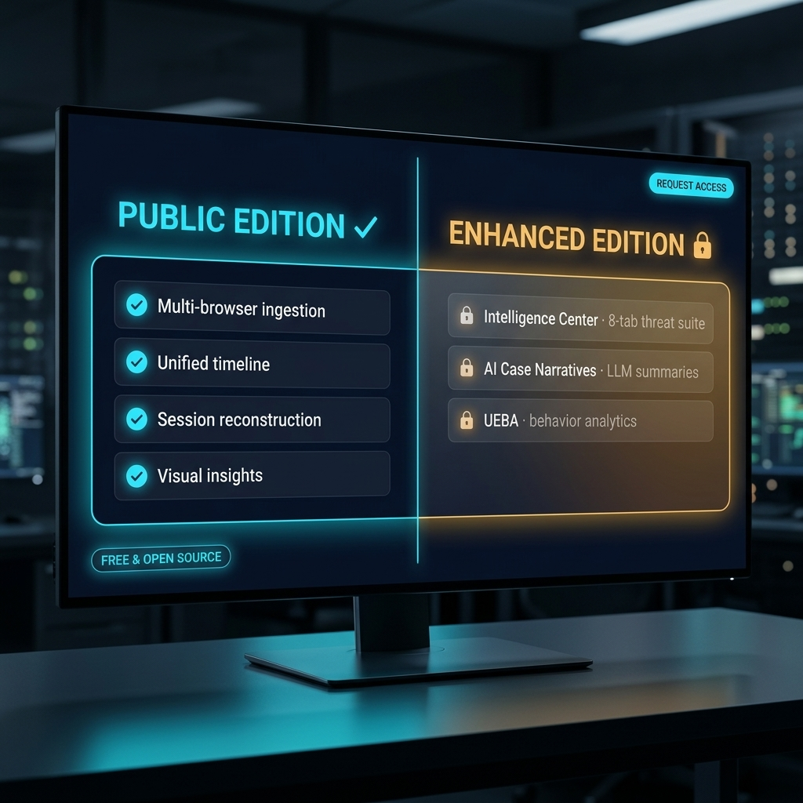

# BrowserRecon

### The Private Digital Archive — Multi-Browser Forensic Timeline & Artifact Explorer

[](#download)
[](LICENSE)
[](#security--verification)
[](#privacy-guarantees)

---

> ### ⚠ Authorized & Lab Use Only
> BrowserRecon is a forensic analysis utility intended for **controlled labs and authorized digital-forensics investigations**. Unauthorized access to another person's browser data is a criminal offense in most jurisdictions. Always obtain written authorization before extracting data from any system you do not own.

---

> 💎 **Looking for more?** This is the **Public Edition** — free for personal, educational, and non-commercial use. The **Enhanced Edition** unlocks AI-powered workflows, advanced threat-intelligence modules, **commercial-use licensing**, and priority support. See the [full comparison ↓](#public-edition-vs-enhanced-edition).

## The problem BrowserRecon solves

Every browser stores a goldmine of behavioral evidence — but it's locked in **cryptic SQLite databases, hidden deep in OS profile folders**, and split across browser-specific schemas that nobody outside Google or Mozilla has memorised.

If you've ever tried to investigate browser activity, you've hit one of these:

- 😤 **"I need to query 5 different schemas across 3 different browsers to answer one question"** — Chrome / Edge / Brave / Opera / Vivaldi all use slightly different SQLite tables; Firefox is completely different again
- 💸 **"The commercial DFIR suite costs $20k/year per seat and we just need browser triage"** — Magnet AXIOM and X-Ways are powerful but priced for enterprise IR teams, not single analysts or curious parents
- 🐢 **"I'm waiting for the lab to image the disk before I can even start"** — Most tools force you through a chain-of-custody pipeline you don't always need
- 🔒 **"I refuse to upload browser history to a cloud service"** — Online "history viewers" demand you ship your evidence to their server; that's a non-starter for forensic work
- 🤷 **"The timeline is hour-by-hour but I need to see *patterns*"** — Raw log dumps don't show clustering, hot domains, behavioural rhythms

BrowserRecon collapses all of that into a **single offline desktop tool that anyone can run**.

---

## What it does

- Ingests **Chrome, Edge, Firefox, Brave, Opera, Vivaldi** artifacts (history, downloads, bookmarks, autofill, cookies, cache metadata)
- Builds a **unified timeline** across every browser and profile on the machine
- Reconstructs **sessions** — what tabs were open, when, and how the user navigated between them
- Explores **artifacts** with a fast, searchable UI — no SQL knowledge required
- Renders **visual insights** — domain treemap, timeline drilldown, behavioral heatmap
- Exports **investigation bundles** ready for case files
- Runs **100% offline** — no telemetry, no cloud calls, read-only ingestion, in-memory evidence storage

---

## Download

Grab the signed Windows release directly from this repo:

| File | What it is |
|---|---|
| [`BrowserRecon-Portable-v1.0.0-windows.zip`](BrowserRecon-Portable-v1.0.0-windows.zip) | Portable bundle — extract anywhere, double-click `BrowserRecon.exe` |
| [`BrowserRecon-Setup-v1.0.0-windows.exe`](BrowserRecon-Setup-v1.0.0-windows.exe) | NSIS installer — adds Start Menu shortcut |
| [`BrowserRecon-v1.0.0-windows-x64.msi`](BrowserRecon-v1.0.0-windows-x64.msi) | MSI for enterprise deployment via Group Policy / SCCM |

Each ships with a `.sigstore.json` signature for provenance verification — see [Security & Verification](#security--verification).

---

## Quick Start

1. Extract the `.zip` (or run the installer) anywhere — USB stick, network share, `C:\Tools\`, your choice.
2. Double-click **`BrowserRecon.exe`**.
3. Load a browser profile folder or a forensic disk image — BrowserRecon does the rest.

No Python, no Node.js, no admin rights required.


---

## Who it's for

| Persona | Why they use it |
|---|---|
| **🕵️ Triage Analyst** | Rapid signal ingestion on a field machine or forensic image. No heavy install. No license overhead. |
| **🛡️ DFIR Responder** | First-pass browser-artifact review before deciding whether to pull in the full enterprise toolchain. |
| **🛡️ Privacy Advocate** | Audit your own digital footprint before trackers do. Discover exactly what your browser metadata says about your habits — in 100% private. |
| **👨‍👩‍👧‍👦 Concerned Parent** | Review patterns / suspicious domains in a family environment without being a forensic expert. |
| **👨‍🎓 Student / Researcher** | Free, source-available reference implementation of browser-artifact parsing for academic projects. |

---

## Features (Public Edition)

### Core forensics

- **Multi-browser ingestion** — Chromium family (Chrome, Edge, Brave, Opera, Vivaldi) + Firefox family
- **Unified timeline** — every event, every browser, one view, sortable and filterable
- **Session reconstruction** — recover browsing sessions with tab context and navigation chains
- **Artifact explorer** — history, downloads, bookmarks, autofill, cookies, cache metadata
- **Read-only ingestion** — original artifacts never modified; SHA-256 hashes recorded for chain-of-custody
- **In-memory evidence store** — nothing written to disk by default; explicit export only
- **Export bundles** — generate JSON / CSV / HTML case files for evidence submission



### Visual insights


### Privacy guarantees

| Checklist | Status |
|---|:---:|
| 100% Offline Analysis | ✅ |
| Zero External Telemetry | ✅ |
| In-Memory Evidence Storage | ✅ |
| Portable / Air-Gapped Ready | ✅ |
| Read-Only Ingestion | ✅ |
| SHA-256 Integrity Hashing on Source Artifacts | ✅ |

---

## How does BrowserRecon compare?

| Capability | BrowserRecon (Public) | NirSoft BrowsingHistoryView | Hindsight (CCL Solutions) | Magnet AXIOM | X-Ways Forensics |
|---|:---:|:---:|:---:|:---:|:---:|
| **Cost** | Free (non-commercial) | Free | Free / Paid Pro | $4,000+/yr | $1,500+/yr |
| **Multi-browser ingestion** | ✅ Chromium + Firefox | ✅ | ✅ Chromium only | ✅ All major | ✅ All major |
| **Unified timeline across browsers** | ✅ | ⚠️ Per-browser only | ⚠️ | ✅ | ✅ |
| **Session reconstruction** | ✅ | ❌ | ⚠️ | ✅ | ✅ |
| **Visual insights (treemap, heatmap)** | ✅ | ❌ | ❌ | ✅ | ⚠️ |
| **Read-only + SHA hashing** | ✅ | ⚠️ | ✅ | ✅ | ✅ |
| **100% offline** | ✅ | ✅ | ✅ | ✅ | ✅ |
| **No install / portable** | ✅ | ✅ | ⚠️ Python required | ❌ | ❌ |
| **AI investigation summaries** | (Enhanced) | ❌ | ❌ | ⚠️ Add-on | ❌ |
| **8-tab threat-intel suite** | (Enhanced) | ❌ | ❌ | ✅ | ✅ |
| **Learning curve** | Minutes | Minutes | Hours | Days | Weeks |

**Bottom line:** BrowserRecon is the **fast lane between "free but feature-thin" tools (NirSoft, Hindsight) and "powerful but expensive" enterprise suites (AXIOM, X-Ways)**. It gives you 80% of the visual + multi-browser value at 0% of the cost, with a clean upgrade path to AI-powered investigation when you need it.

---

## Real-world use cases

### Case 1 — Insider-threat triage on a corporate laptop
A laptop user is suspected of leaking documents. Pull the user profile, drop it into BrowserRecon, and within minutes you see:
- A spike in visits to a personal-email domain at 11pm
- Multiple downloads of `.zip` and `.7z` files
- A session reconstruction showing the user copied URLs from internal SharePoint into a public file-share form

Total time from "got the profile" to "first finding": ~10 minutes.

### Case 2 — Family safety review
A parent wants to know what sites their teenager is visiting without spying live. They load the browser profile from the family laptop:
- Domain treemap shows clusters around social media and one unfamiliar gaming domain
- Behavioral heatmap reveals 2-3am browsing on school nights
- One drill-down later, they have the full context — no panic, just data

### Case 3 — DFIR first-responder kit
A consultant arrives at a small business after a phishing incident. BrowserRecon ships on their USB stick. They:
- Image each browser profile in seconds (read-only)
- Generate timeline + export JSON case-file
- Hand off to the client's IR retainer for deeper analysis

No client-installed software, no network egress, no cloud uploads.

---

## Public Edition vs Enhanced Edition

The free Public Edition covers complete browser-artifact forensics end-to-end. The **Enhanced Edition** adds three advanced modules powered by your local LLM:

| Capability | Public | Enhanced |
|---|:---:|:---:|
| Multi-browser ingestion + unified timeline | ✅ | ✅ |
| Session reconstruction + artifact explorer | ✅ | ✅ |
| Domain treemap + behavioral heatmap | ✅ | ✅ |
| Investigation bundle export | ✅ | ✅ |
| **Intelligence Center** — 8-tab threat suite (phishing, DGA, typo-squat, extension risk, exfil, credential harvest, URL anomalies, brand impersonation) | — | ✅ |
| **AI Case Narratives** — LLM-driven investigation summaries that turn a 5,000-event timeline into a one-page case brief | — | ✅ |
| **UEBA / Behavior Analytics** — baselines + anomaly detection + "unusual for this user" alerts | — | ✅ |



### Why the Enhanced Edition?

- 🚀 **Modules the Public Edition can't ship** — 8-tab Intelligence Center (phishing, DGA, typo-squat, extension risk, exfiltration, credential harvest, URL anomalies, brand impersonation), AI Case Narratives, UEBA / Behavior Analytics
- 🤖 **AI-augmented investigation** — turn a 5,000-event timeline into a one-page case brief automatically. No more end-of-week report writing.
- 🎯 **Commercial-use license included** — the Public Edition excludes paid client engagements; the Enhanced Edition covers consultancy, IR retainers, and SaaS embedding
- 📈 **All future v1.x and v2.x updates included** — no per-version upgrade fee; your license rolls forward
- 🛟 **Priority support** — direct email channel, response within 48 hours for licensed users
- 🛠 **Roadmap input** — licensed users' feature requests get prioritised; bigger asks can become contracted custom builds
- 🥇 **Early access** — preview builds of upcoming features before public release
- 🏢 **Tailored onboarding** — DFIR team rollouts, lab deployment guidance, custom integration scoping

### Get the Enhanced Edition

- 📧 Email: [mathan1702@gmail.com](mailto:mathan1702@gmail.com)
- 💼 LinkedIn: [linkedin.com/in/mathan-subbiah-0bb47aa8](https://www.linkedin.com/in/mathan-subbiah-0bb47aa8/)
- 🌐 Website: [mathanport.netlify.app](https://mathanport.netlify.app/)


### 🎁 Free for personal use — paid for enterprise

**The Enhanced Edition is given away free of charge for non-commercial use.** Just ask. The following uses qualify and cost nothing:

- 🎓 Students, researchers, classroom teaching, academic papers
- 🏠 Personal projects, hobbyist tinkering, self-hosted home labs
- 🏆 CTFs, security conferences, blue / purple-team training exercises
- 🛡️ Independent security research and bug-bounty hunting

Email or LinkedIn-DM me a one-line description of what you're using it for, and I'll send the Enhanced binary + unlock instructions within 48 hours. No forms, no sales calls, no NDAs.

**Commercial / enterprise use requires a paid licence.** That covers:

- 💼 Paid client engagements (consultancy, MSSP, SOC-as-a-Service, IR retainers)
- 🏢 Deployment inside a for-profit organisation with > 25 employees
- 🧩 Embedding in or bundling with a commercial product / SaaS offering
- 🔁 Resale, sub-licensing, or re-distribution

For commercial enquiries the [contact form on my website](https://mathanport.netlify.app/) is the fastest path; quotes typically returned within 24 hours.

---

## FAQ

**Q: Is this legal to use on someone else's machine?**
Only with explicit written authorization, or on machines you own / administer. Browser artifacts are personal data in most jurisdictions. Treat BrowserRecon like a power tool — it has legitimate forensic uses, and unauthorized use can be a crime.

**Q: Does it phone home?**
No. The app makes zero outbound network connections. You can confirm with a packet capture or by running it on an air-gapped machine.

**Q: Will Windows SmartScreen warn me on first launch?**
Yes. The binary is signed with Sigstore (provenance proof), not with a Microsoft-trusted commercial certificate. Click "More info" → "Run anyway". To verify the signature first, use the `scripts/verify.ps1` helper.

**Q: Does it modify the original browser data?**
No. Ingestion is strictly read-only. SHA-256 hashes are recorded for every source artifact so you can prove non-tampering in a chain-of-custody context.

**Q: Why no Chrome extensions analysis in the public edition?**
That's part of the Enhanced Edition's **Extension Risk** tab — it requires more advanced parsing of the extension manifest + dynamic permission analysis that's not in the free build. Email me if you need it.

**Q: Can it analyse mobile browser data?**
Not directly. You'd need to first extract the SQLite files from a mobile backup (iOS Backup, ADB pull for Android), then point BrowserRecon at them. iOS Safari and Android Chrome use similar schemas to their desktop versions.

**Q: What about Tor Browser?**
Tor Browser is intentionally amnesic — it doesn't persist history. There's nothing to analyse.

**Q: How big can a profile be before performance degrades?**
Tested smoothly up to ~250,000 history entries on a 16GB RAM machine. Beyond that, expect ingestion to take a few minutes but the UI stays responsive.

**Q: Can I script it / use it in CI?**
The public edition is GUI-only. A CLI mode is on the Enhanced Edition roadmap — email me if that's a need.

**Q: Why is the .exe so small (~7 MB)?**
Built with a native Windows architecture that reuses the system WebView2 rather than bundling an entire browser engine. Much smaller than Electron-based competitors.

---

## Roadmap

- **v1.1** — Native Linux + macOS builds
- **v1.2** — CLI mode for scripted ingestion
- **v2.0** — Mobile browser profile support (iOS Safari, Android Chrome)
- **Enhanced v1.0** — already shipping (contact for licensing)

---

## Security & Verification

The release binaries in this repo are signed with **Sigstore**. The signature is bound to my GitHub identity (`PrototypePrime`) and recorded on the public **Rekor transparency log**.

### How to verify a download

```powershell
.\scripts\verify.ps1 BrowserRecon-Portable-v1.0.0-windows.zip
```

Returns `VERIFIED OK` if the signature matches.

### Important caveat

Sigstore proves **provenance** (*who built this and from what*) — it is **not** Windows Authenticode. SmartScreen will still warn "unrecognized publisher" on first launch. To silence SmartScreen would require a commercial OV/EV certificate (~$300-500/year) — out of scope for v1.0.0.

---

## License

Free for **personal, educational, and non-commercial use**. Commercial use requires a separate license — see [`LICENSE`](LICENSE).

---

<div align="center">

*Built by [Mathan Subbiah](https://mathanport.netlify.app/) — Detection Engineering · DFIR · AI*

[📧 Email](mailto:mathan1702@gmail.com) · [💼 LinkedIn](https://www.linkedin.com/in/mathan-subbiah-0bb47aa8/) · [🌐 Website](https://mathanport.netlify.app/)

</div>

